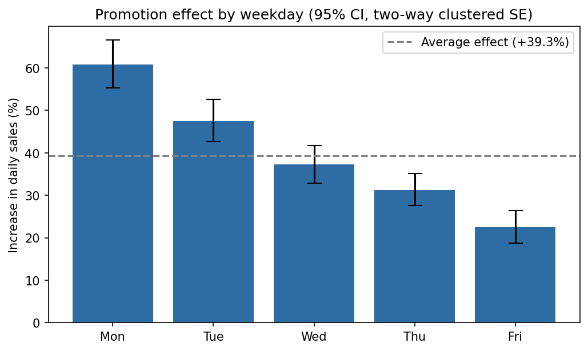
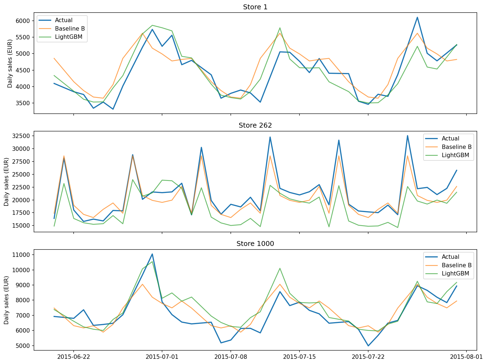
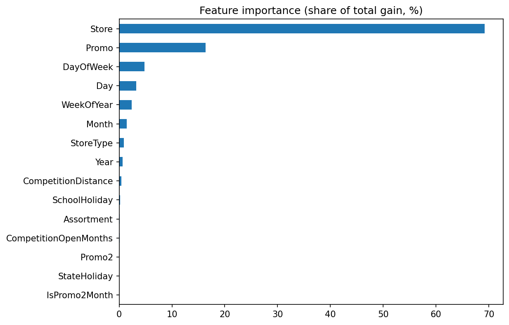

# Rossmann Store Sales: Promotion Effect and Sales Forecasting

How much do promotions increase daily sales in Rossmann drugstores, and how well can
daily sales be forecast six weeks ahead?

This project analyses daily sales data from 1,115 Rossmann stores in Germany
(January 2013 – July 2015). It combines exploratory analysis, a panel regression to
estimate the promotion effect, and a comparison of forecasting models.



## Key results

- **Promotion effect:** After controlling for day of week, season, holidays and store
  differences, daily sales are about **39% higher on promotion days**
  (95% CI: 37% to 42%, standard errors clustered by store and date).
- **The effect depends on the weekday:** about **+61% on Mondays** and **+23% on Fridays**.
  The difference between Monday and Friday is statistically significant
  (Wald test, χ² = 130.2, p < 0.001).
- **Forecasting:** A LightGBM model reduces the forecast error compared with a simple
  baseline (RMSPE 13.1% vs. 14.7%, MAE 622 vs. 744). However, the baseline already
  captures most of the predictable variation: store, promotion and weekday explain most
  of the sales pattern.
- **Pitfalls found in the data:** Several patterns that look like effects turned out to be
  caused by selection bias or confounding (see [Exploratory analysis](#exploratory-analysis)).

## Data

The data comes from the Kaggle competition
[Rossmann Store Sales](https://www.kaggle.com/competitions/rossmann-store-sales/data).
Two files are used:

- `train.csv`: daily sales, customers, promotions and holidays per store (1,017,209 rows)
- `store.csv`: store attributes such as store type, assortment and competition (1,115 stores)

The data is **not included** in this repository. To run the notebooks, download it from
Kaggle (you need to accept the competition rules first) and place both files in `data/`.

## Project structure

```
rossmann-sales-analysis/
├── data/                              # not included, see "Data"
├── figures/                           # plots used in this README
├── notebooks/
│   ├── 01_data_preparation.ipynb      # data quality checks, cleaning, merge
│   ├── 02_eda.ipynb                   # exploratory data analysis
│   ├── 03_promo_effect.ipynb          # panel regression for the promotion effect
│   └── 04_forecasting.ipynb           # baseline vs. LightGBM forecast
├── requirements.txt
└── README.md
```

## Methods

### 1. Data preparation
- Removed closed days (`Open = 0`, 172,817 rows) and 54 open days with zero sales
  (likely recording errors).
- Found that about 180 stores have no data from July to December 2014. For time trends,
  average sales per store are used instead of total sales.
- Missing `Promo2` dates are structural: they belong only to stores without Promo2.
- Saved the cleaned data (844,338 rows) as Parquet to keep data types.

### 2. Exploratory analysis
See [findings](#exploratory-analysis) below.

### 3. Promotion effect (panel regression)
- Outcome: `log(Sales)`, so coefficients can be read as percentage changes.
- Three models with increasing controls: (1) promotion only, (2) + day of week, month,
  year and holidays, (3) + store fixed effects.
- Model 4 estimates a separate promotion effect for each weekday.
- Standard errors are clustered by store and date (two-way), because promotions vary by
  date, not by store.
- Sundays are excluded (only 33 special stores are open, and promotions never run on Sundays).
- Library: `linearmodels` (`PanelOLS`).

### 4. Forecasting
- Time-based split: the last 6 weeks are the test set. The 6 weeks before are used as a
  validation set for early stopping. The test set is used only once, at the end.
- Only features that are known in advance are used. `Customers` is excluded to avoid
  data leakage.
- Baseline: average sales per store, weekday and promotion status.
- LightGBM trained on `log(1 + Sales)`.
- Metrics: RMSPE (the official Kaggle metric) and MAE.

## Results

### Promotion effect

| Model | Controls | Promo effect | 95% CI |
|---|---|---|---|
| 1 | none | +41.5% | +40.4% to +42.6% |
| 2 | day of week, month, year, holidays | +39.3% | +38.6% to +40.1% |
| 3 | + store fixed effects | +39.3% | +38.6% to +40.0% |
| 3 | two-way clustered SE (store and date) | +39.3% | +37.0% to +41.6% |

Controlling for time reduces the estimate, because all low-sales Saturdays fall into the
non-promotion group. Store fixed effects do not change the estimate, because promotions
are scheduled chain-wide: on every date, all stores have the same promotion status.

| Day | Promo effect | 95% CI |
|---|---|---|
| Mon | +60.8% | +55.3% to +66.5% |
| Tue | +47.5% | +42.6% to +52.7% |
| Wed | +37.2% | +32.8% to +41.8% |
| Thu | +31.3% | +27.6% to +35.1% |
| Fri | +22.5% | +18.8% to +26.4% |

### Forecasting

| Model | RMSPE | MAE |
|---|---|---|
| Baseline (store × weekday × promo average) | 14.7% | 744 |
| LightGBM | 13.1% | 622 |

LightGBM improves on the baseline for all store types, with the largest gains for
type-b stores and promotion days.



Store, promotion and weekday account for about 90% of the model's feature importance.
Store attributes (type, assortment, competition) have low importance because the store
feature already contains this information.



## Exploratory analysis

The most important lesson from the exploratory analysis: several simple comparisons are
misleading.

- **Selection bias on Sundays and holidays:** Average sales look high on Sundays and public
  holidays. But only a few special stores (e.g. at train stations) are open on those days.
  Within the 33 Sunday-open stores, Sunday sales are lower than weekday sales.
- **Confounding by promotions:** Saturdays seem to be weak sales days. But promotions never
  run on Saturdays. Without promotions, Saturday sales are at a normal weekday level.
- **Location as a confounder:** Stores with a competitor nearby have higher sales. This is
  likely because competitors cluster in busy urban areas, not because competition increases
  sales.
- **Seasonality:** Strong peak in December, drop in January, slight upward trend over time.
- **Store structure:** Store types reach similar sales in different ways (more customers vs.
  larger baskets). All 17 type-b stores are open on Sundays, which suggests special
  high-traffic locations.

## Limitations

- **Promotions were not randomly assigned.** Because they are scheduled chain-wide, the
  effect is identified only by comparing promotion days with non-promotion days. Anything
  else happening chain-wide on promotion days (e.g. advertising) is part of the estimated
  effect.
- The analysis shows higher sales on promotion days. It cannot tell whether promotions create
  additional sales or partly shift purchases from other days.
- The forecasting models use no information about recent sales levels (lag or rolling
  features). They react slowly when the level of a store changes.
- Very high peaks (e.g. Sundays in type-b stores) are underestimated.
- Hyperparameters were not tuned systematically.

## How to run

The notebooks were developed in Google Colab with the data stored in Google Drive.

1. Create the folder `rossmann-sales-analysis` in your Google Drive with the subfolders
   `data/`, `figures/` and `notebooks/`.
2. Download `train.csv` and `store.csv` from Kaggle and upload them to `data/`.
3. Open the notebooks in Colab and run them in order (01 → 04). Notebook 01 creates
   `train_clean.parquet`, which the other notebooks use.

To run locally instead, install the packages with `pip install -r requirements.txt` and
change `DATA_DIR` and `FIG_DIR` at the top of each notebook. Tested with Python 3.13.

## Tools

Python · pandas · NumPy · Matplotlib · linearmodels · LightGBM · Google Colab

## Author

Mina Mottaghinasab, M.Sc. Data Science student at TU Dortmund
[LinkedIn](https://www.linkedin.com/in/m-motaghinasab) ·
[GitHub](https://github.com/mina-motaghinasab)
